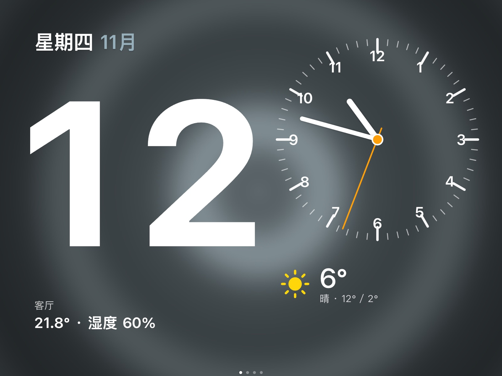
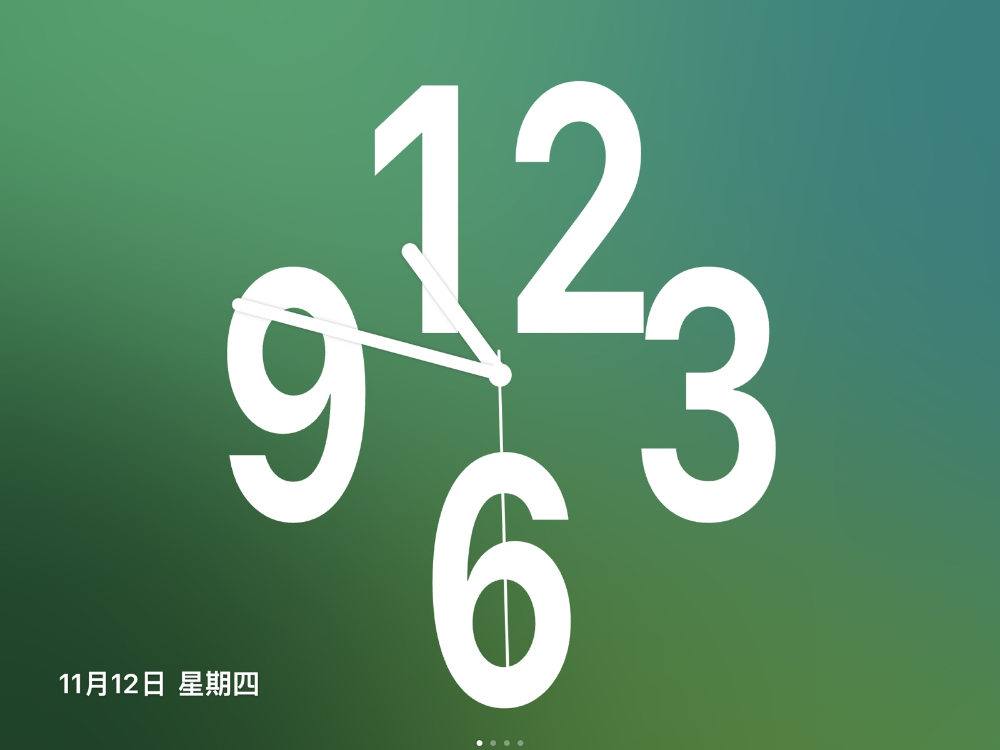
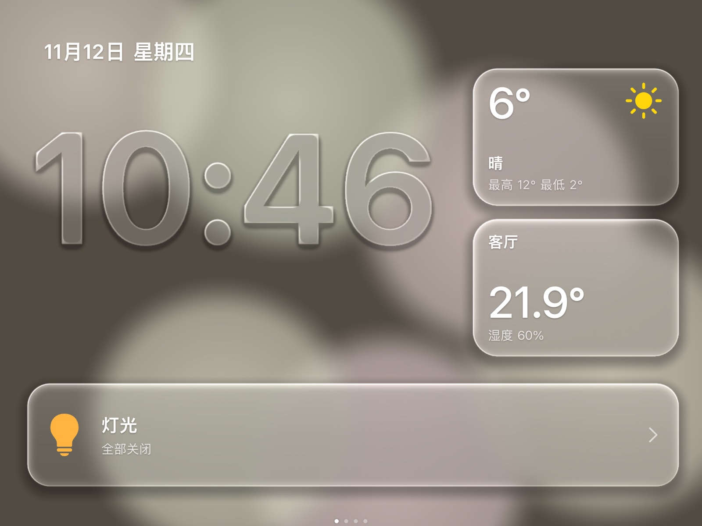
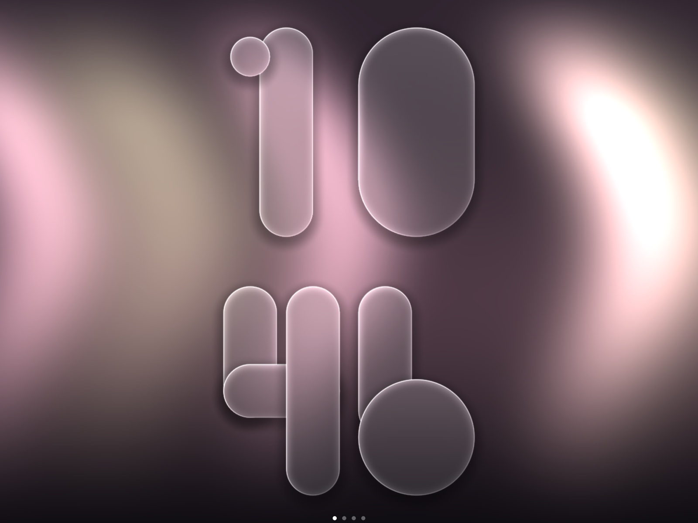
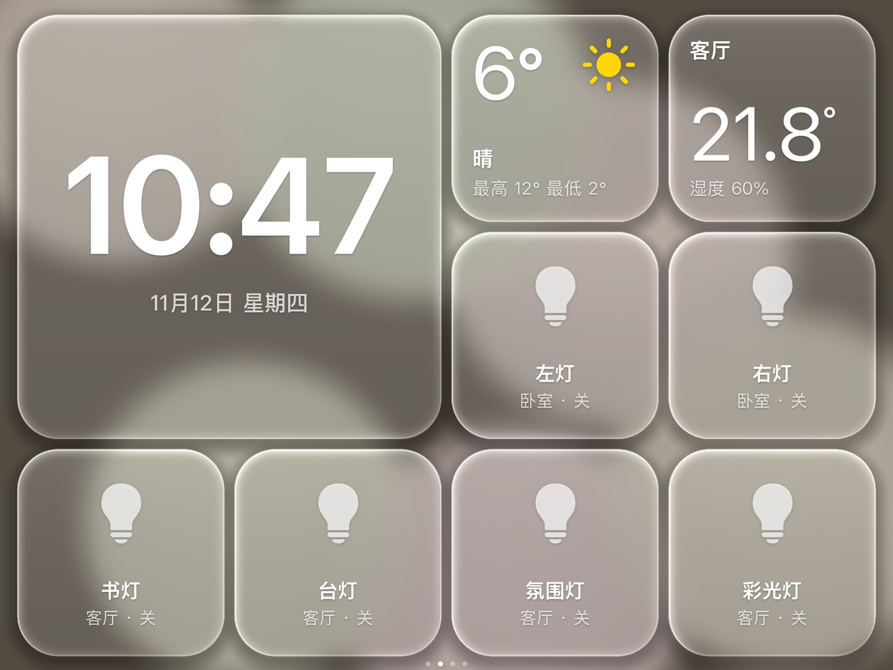
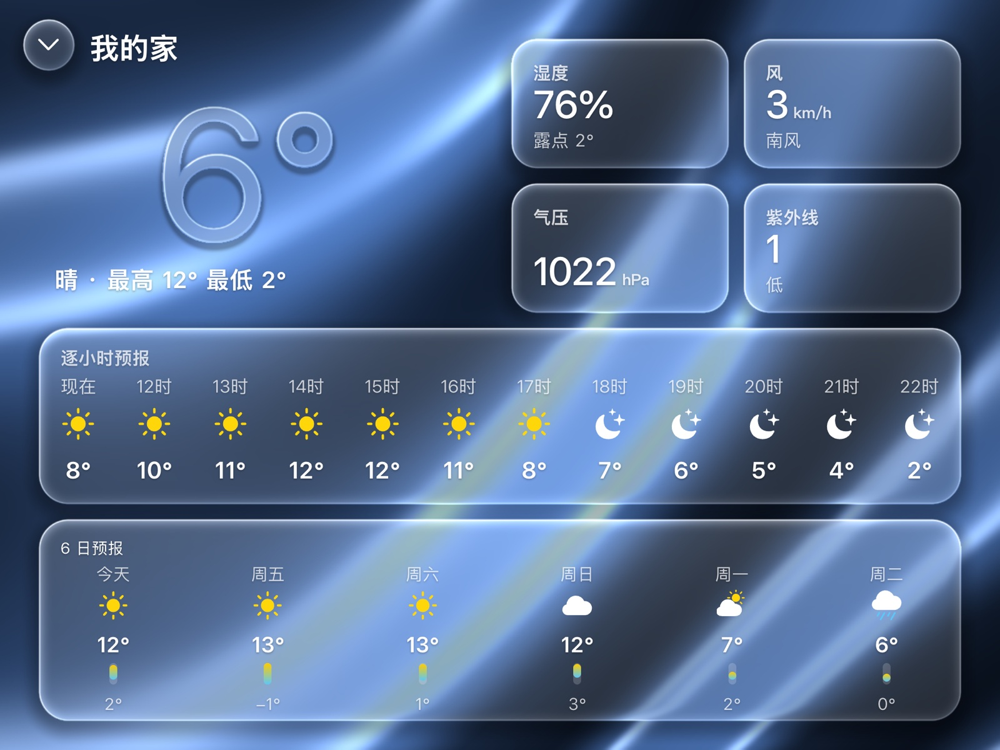
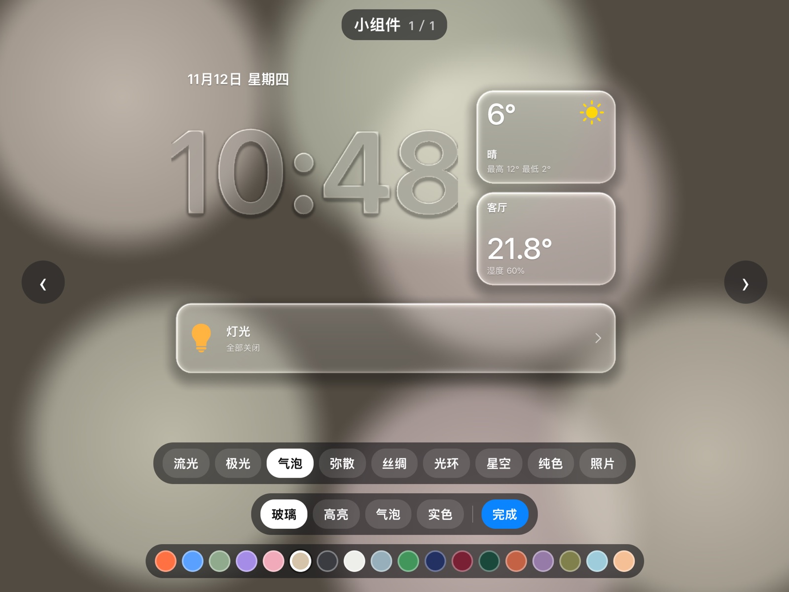
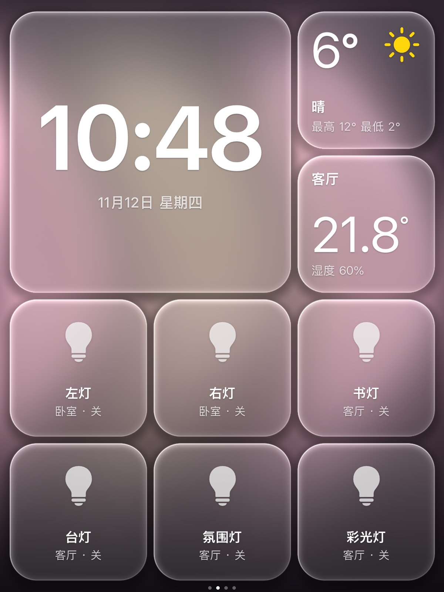

# HomeView for iPad Air 2

把一台旧 iPad Air 2 改成 HomeView 风格的家庭中控屏，所有功能都在 iPad 本机运行，不依赖 Mac 或额外服务器：

- **WebGL 液态玻璃界面**：动态壁纸，加上多个磁贴共用一次模糊的玻璃效果，iPad Air 2 上能稳定 60 fps
- **直连 Home Assistant**（WebSocket）：灯光、温湿度、天气；HA 不可用时天气自动改用 Open-Meteo
- **8 种表盘**：数字、指针、大数字、天气、日历等；9 种动态背景，也可以用相册照片（单张或多张渐变轮播）；18 套配色；数字支持玻璃、高亮、气泡等样式
- **小应用**：计时器、天气
- **常亮屏保护**：每 90 秒像素偏移防烧屏；夜间自动调暗（不降帧）
- **电池保护**：长期插电时用 ChargeLimiter 把电量控制在 50–60%
- **语音唤醒（已验证，还没接进主应用）**：sherpa-onnx 本地关键词识别，唤醒词“你好小家”，约占单核 22%

> 需要已越狱（Dopamine）并装好 TrollStore 的 iPad，系统为 iPadOS 15。本项目和 Apple 没有任何关系，“HomeView”只是用来描述界面风格。

## 截图

<table>
  <tr>
    <td><br><sub>信息表盘 · 光环背景</sub></td>
    <td><br><sub>数字·指针表盘 · 弥散背景</sub></td>
  </tr>
  <tr>
    <td><br><sub>小组件表盘 · 玻璃数字</sub></td>
    <td><br><sub>大数字表盘 · 气泡数字 · 极光背景</sub></td>
  </tr>
  <tr>
    <td><br><sub>主页 · 直连 Home Assistant</sub></td>
    <td><br><sub>天气 · 逐小时和 6 日预报</sub></td>
  </tr>
  <tr>
    <td><br><sub>长按进入表盘库：9 种背景 · 4 种数字 · 18 种配色</sub></td>
    <td align="center"><br><sub>竖屏自适应</sub></td>
  </tr>
</table>

<sub>截图由同一套网页在 Mac 上用 Chrome 渲染（2x），连接真实的 Home Assistant 数据；在 iPad 上的效果和截图一致。</sub>

## 目录

| 路径 | 内容 |
| --- | --- |
| [`spike/`](spike/) | **前期**：可行性验证，包括 GPU 帧率、麦克风、HA 延迟和唤醒词测试，以及实测数据 |
| [`app/`](app/) | **中期**：正式应用，Swift 外壳（WKWebView）加 Web 前端 |
| [`docs/`](docs/) | 前期、中期、后期三个阶段的过程记录和配置说明 |

- [docs/01-前期-可行性验证.md](docs/01-前期-可行性验证.md)：方案选择、实测数据和最后的决定
- [docs/02-中期-应用开发.md](docs/02-中期-应用开发.md)：架构、渲染管线、配置项、开发流程
- [docs/03-后期-部署与运维.md](docs/03-后期-部署与运维.md)：安装、电池保护、夜间调暗、HA/HomeKit 配置和踩过的坑

## 快速开始

```sh
cd app
cp config.example.json config.json            # 改成你自己的 HA 地址和实体
mkdir -p ~/.config/homeview && echo '<HA 长期访问令牌>' > ~/.config/homeview/ha_token && chmod 600 ~/.config/homeview/ha_token
python3 tools/dev-server.py                    # 先在 Mac 浏览器里预览 http://127.0.0.1:8780/
sh build.sh                                    # 生成 dist/HomeView.tipa（需要 Xcode）
```

把 `.tipa` 放到 iPad 的“文件 → 我的 iPad”，用 TrollStore 安装，然后执行 `IPAD=mobile@<iPad IP> tools/deploy.sh config` 写入配置和令牌。详细步骤见 [docs/03](docs/03-后期-部署与运维.md)。

令牌只放在 Mac 的 `~/.config/homeview/ha_token` 和 iPad 应用沙盒里的 `Documents/config.json`（权限 600），不会进入代码仓库，也不会打包进 App。

## 致谢

- 布局和天气图标参考 [homeview-g4](https://github.com/Jesser722000/homeview-g4)（MIT），见 `app/LICENSE-homeview-g4.txt` 和 `app/THIRD_PARTY_NOTICES-homeview-g4.md`
- 关键词识别：[sherpa-onnx](https://github.com/k2-fsa/sherpa-onnx)（Apache-2.0）
- 天气备用数据：[Open-Meteo](https://open-meteo.com/)（CC BY 4.0）
- 电池管理：[ChargeLimiter](https://github.com/lich4/ChargeLimiter)

## 许可证

[MIT](LICENSE)
